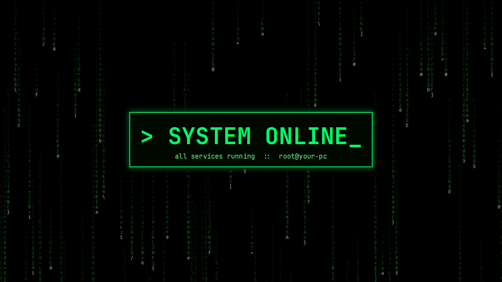

# Ubuntu Hacker Theme

Turn Ubuntu's desktop black and neon green, movie-hacker style, with one command.



## What you get

| Part | What changes |
|---|---|
| **Wallpaper** | Matrix code rain with a glowing `> SYSTEM ONLINE_` panel showing your computer's name |
| **Look** | Dark mode, green accent, IBM Plex Sans for apps, JetBrains Mono for code |
| **Icons** | Every Papirus app icon recoloured neon green, plus green folders |
| **Cursor** | Neon-green pointer with black outlines |
| **Top bar** | Black with a glowing green edge, plus live `CPU │ RAM │ ↓ ↑ │ Tailscale IP` stats (click for a system monitor) |
| **Dock** | Black with a green outline and green running-app indicators |
| **Notifications** | Black pop-ups with green borders |
| **Terminal** | Green-on-black colours, a two-line prompt with the time, command duration and git branch, a typed-out welcome, and a block-letter banner with system info |
| **Drop-down terminal** | Press **F12** and a terminal slides down from the top of the screen |
| **Unknown commands** | `[ACCESS DENIED] command 'gti' not recognised`, with suggestions |
| **Screen saver** | Matrix rain after 3 minutes idle (skipped while video plays; closes on any input) |
| **Sounds** | Short retro beeps for notifications, alerts and USB plug/unplug, and a chirp at login |
| **Brave** | Black and green browser theme (only if Brave is installed) |

Terminal banner example (it uses your own name):

```
    ▄▄▄  ▄▄▄    ▄▄▄      ▄▄▄▄    ▄▄▄  ▄▄▄ ▄▄▄▄▄▄▄▄  ▄▄▄▄▄▄
    ███  ███    ████   ▄██▀▀██▄  ███ ▄██▀ ███▀▀▀▀▀  ███▀▀██▄
    ███  ███   ██▀██   ██▀   ▀   ███ ██▀  ███       ██   ███
    ████████   ██ ▀██  ██        ██████   ███████   ███▄▄██▀
    ███  ███  ███████  ██▄   ▄   ███ ██▄  ███       ██▀▀██
    ███  ███  ██   ███ ▀██▄▄██▀  ███  ██▄ ███▄▄▄▄▄  ██  ▀██
    ▀▀▀  ▀▀▀ ▀▀▀    ▀▀   ▀▀▀▀    ▀▀▀  ▀▀▀ ▀▀▀▀▀▀▀▀  ▀▀   ▀▀▀
```

## Requirements

- **Ubuntu 26.04** with the default GNOME desktop (GNOME 50). This is the only version it has been
  tested on. On other versions the installer stops; `--force` lets you try anyway.
- The default **Ptyxis** terminal.

## Install

```bash
sudo apt install git
git clone https://github.com/SamyogKarki/ubuntu-hacker-theme.git
cd ubuntu-hacker-theme
./install.sh
```

If any packages are missing, the installer stops and prints the exact `sudo apt install ...`
line to run. The installer itself never uses `sudo`.

Then **log out and back in**. The top bar, dock outline, stats and F12 terminal load at login.

Options:

```bash
./install.sh --name NEO     # banner text (default: your username, up to 10 letters)
./install.sh --force        # try on a GNOME version other than 50
```

## Uninstall

```bash
./uninstall.sh
```

This puts back every setting the installer changed, removes everything it added, restores any
file it replaced, and removes its block from `~/.bashrc`. Log out and back in afterwards.
Packages installed with apt stay installed; the uninstaller prints the command to remove them.

## Safety: what it touches

Everything happens inside your home folder, as your own user:

- **Settings:** about 30 GNOME settings (wallpaper, theme, fonts, icons, cursor, sounds, dock,
  terminal). Each setting's old value is saved to
  `~/.local/share/ubuntu-hacker-theme/restore-gsettings.sh` before it's changed.
- **Generated themes:** `~/.local/share/icons/Papirus-Hacker`, `~/.local/share/icons/Hacker-Cursor`
  and `~/.local/share/sounds/hacker` are built on your PC from Papirus, Yaru and a small synthesiser.
  The green icons take about 180 MB.
- **Extensions:** two GNOME Shell extensions, `hacker-panel` (CSS only) and `hacker-tools`
  (stats and drop-down terminal), in `~/.local/share/gnome-shell/extensions/`.
- **Config files:** fastfetch, btop and terminal-palette config files, a user service for the screen saver, an
  autostart entry for the login sound, and launcher copies for Brave and a few snap apps so they
  use green icons. Any existing file it replaces is backed up first.
- **`~/.bashrc`:** a block between `# >>> hacker-theme >>>` and `# <<< hacker-theme <<<`.

It does **not** change the login screen, boot screen, lock screen or any system files.

## Good to know

- **F12** opens the drop-down terminal everywhere, so apps don't receive F12. In browsers, use
  **Ctrl+Shift+I** for developer tools instead.
- **Brave** may show a "Disable developer mode extensions" popup at start-up now and then.
  Close it with the **X**; clicking *Disable* turns the theme off until Brave restarts.
- The `cat` command shows colours (via `bat`) but falls back to the real `cat` when you pass options.
- If Papirus updates and adds new icons, run `./install.sh` again to make them green too.

## License

MIT. See [LICENSE](LICENSE). The green icons and cursors are generated on your own computer from
the Papirus (GPL-3.0) and Yaru (CC BY-SA 4.0) themes installed there; this repository doesn't
contain or redistribute them.
